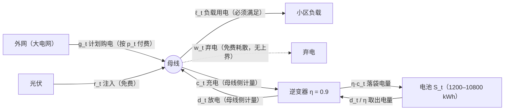

# 母线与电量流转路线（全题物理图景）

> 一张图讲清：母线是什么、每度电从哪来到哪去、模型变量在图上的位置、
> 效率损失发生在哪、为什么模型按"母线侧"建而表 2 按"电池侧"报。
> 题 1–4 共用此图景，论文建议将其重绘为矢量示意图放在"模型假设"节之前。

---

## 1. 全景图



纯文本版（渲染器不支持 mermaid 时看这张）：

```
外网 ──g_t──►  ┌────────┐  ──ℓ_t──►  小区负载
（购电付费）    │        │
光伏 ──r_t──►  │  母线  │  ┄┄w_t┄┄►  弃电（免费耗散）
（免费注入）    │        │
              └──┬──▲──┘
             c_t │  │ d_t          ← 母线侧计量：单时段各 ≤ 833.33 kWh
              ┌──▼──┴──┐
              │ 逆变器  │           ← η = 0.9，效率损失发生在这里
              └──┬──▲──┘
            η·c_t│  │ d_t/η        ← 电池侧计量：η·c_t 落袋，d_t/η 取出
              ┌──▼──┴──┐
              │ 电池 S_t│            1200 ≤ S_t ≤ 10800 kWh
              └────────┘
```

---

## 2. 母线（bus）是什么

**母线是微网内部所有电源与负荷共同挂接的电气节点**——外网关口、光伏逆变器、
小区负载、储能变流器（逆变器）都接在它上面。可以把它想象成一根"电源插排"：
所有电在这里汇合，也从这里被取走。

它有一条关键物理性质：**母线本身不能储存电能，任一时刻流入必须等于流出**。
这句话直接翻译成数学，就是模型的供需平衡方程：

$$\underbrace{g_t + r_t + d_t}_{\text{流入母线}} = \underbrace{\ell_t + c_t + w_t}_{\text{流出母线}}$$

光伏注入超出消纳能力的部分只能弃掉（$w_t$）——弃电不是"漏电"，而是主动耗散。

---

## 3. 六条流 + 电池内部两段路径

| 符号 | 起点 → 终点 | 含义 | 计量侧 | 费用/上限 |
|---|---|---|---|---|
| $g_t$ | 外网 → 母线 | 计划购电 | 关口侧 | 按 $p_t$ 付费，无功率上限 |
| $r_t$ | 光伏 → 母线 | 光伏注入 | 母线侧 | 免费，不可卖回 |
| $\ell_t$ | 母线 → 负载 | 负载用电 | 母线侧 | 硬约束：必须满足 |
| $w_t$ | 母线 → 耗散 | 弃电 | 母线侧 | 免费、无上界 |
| $c_t$ | 母线 → 逆变器 | 充电（模型变量） | **母线侧** | $\le 833.33$ kWh/时段 |
| $d_t$ | 逆变器 → 母线 | 放电（模型变量） | **母线侧** | $\le 833.33$ kWh/时段 |
| $\eta c_t$ | 逆变器 → 电池 | 落袋电量 | **电池侧** | 表 2 报表口径 |
| $d_t/\eta$ | 电池 → 逆变器 | 取出电量 | **电池侧** | 表 2 报表口径 |

## 4. 效率 η = 0.9 的两个作用点

逆变器是唯一"吃掉"电能的环节，且**双向都吃**：

- 充电：母线流出 $c_t$（比如 100 kWh）→ 电池只落袋 $\eta c_t$（90 kWh）；
- 放电：电池取出 $d_t/\eta$（比如 100 kWh）→ 母线只收到 $d_t$（90 kWh）。

一来一回剩 $\eta^2 = 0.81$——这就是套利门槛 $p_j/p_i \ge 1/\eta^2 \approx 1.2346$
（题 1 变量定义 §7.2）的物理来源。

## 5. 为什么模型按母线侧建、表 2 按电池侧报

- **母线侧建模**（$c_t, d_t$）：与供需平衡方程同口径、与 5000 kW 功率上限同口径，
  求解器直接输出；
- **电池侧报表**（$\eta c_t,\ d_t/\eta$）：表 2 同时要填 0:00 / 24:00 储电量，
  电池侧口径下成立恒等式 $\sum_k C_k^{\mathrm{bat}} - \sum_k D_k^{\mathrm{bat}} = S_{144} - S_0 = 0$，
  读者可直接对账；母线侧口径则恒差一个往返损耗（约 19%），对不上账。

两层口径各司其职，换算只发生一次（导出表 2 时），论文中一句话声明即可。

## 6. 读图即读模型

| 图上看到 | 对应模型 |
|---|---|
| 母线节点流入 = 流出 | 供需平衡 $g_t + r_t + d_t = \ell_t + c_t + w_t$ |
| 沿电池路径记账 | SOC 递推 $S_t = S_{t-1} + \eta c_t - d_t/\eta$ |
| 电池水位区间 | $1200 \le S_t \le 10800$ |
| 逆变器双向限流 | $0 \le c_t, d_t \le 833.33$（= 5000 kW × 1/6 h） |
